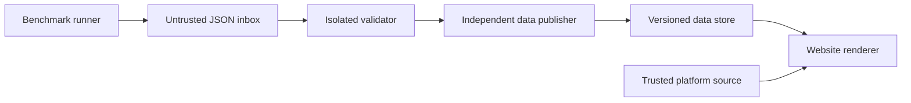

# Nightly federation benchmark updates

The website renders a fixed example at `/benchmarks/graphql-federation` from
`website/public/benchmarks/federation/latest.json`. Automatic ingestion is not
enabled. The example transcribes the published real-world and synthetic tables
from run 399 at report commit `5be2f9523440c79c885b442129d73b58717cac57`.
That snapshot has one measured repetition and no published burst results. It
retains the pending scenario rather than combining measurements from other runs.

## Proposed trust boundary

Treat the benchmark repository, its workflow definitions, its artifacts, and its
dedicated runner as compromised inputs. They must have no credentials,
installation tokens, network access, runner membership, or repository permissions
that grant access to graphql-platform, its build caches, package publishing, or
website deployment. Remove inherited organization secrets and shared credentials
from the benchmark environment. Restrict sensitive runner groups to explicitly
selected repositories. Credentials used to publish benchmark output must be
limited to a separate data inbox.

The recommended automatic path updates a separate data store. It does not create
branches, commits, pull requests, or workflow dispatches in graphql-platform.
The website renderer and the publication service remain controlled by trusted
maintainers. GitHub warns that privileged workflows consuming untrusted code or
artifacts can compromise a repository, including through shared caches.
[GitHub Actions secure use reference](https://docs.github.com/en/actions/reference/security/secure-use).

## Producer contract

After all nightly scenarios finish, the benchmark workflow emits one UTF-8
`report.json`. It contains schema version 1, run identity, immutable source and
report commit IDs, hardware, subgraph version, and three scenario records.
Each scenario declares its actual duration, concurrency, artificial I/O delay,
discarded warmup count, measured repetition count, status, and gateway results.
Each gateway result contains an allowlisted identity, exact version, outcome,
median/best/worst RPS, and CV percentage. Unsuccessful results have null metrics.
The required `memory` field is either null or an object containing `peakRssKiB`
and its source `artifactId`. Peak RSS is the highest sampled gateway process
tree RSS in the successful measured run selected for median RPS, excluding k6
and subgraphs. It is not the median of peak RSS values across repetitions.
The website displays KiB divided by 1,024 as MiB and links each value to its
source artifact. Missing memory is null and is displayed as not reported.
Verify that the memory artifact belongs to the same workflow run and that its
gateway, version, scenario, and selected RPS match the result. Verify its archive
SHA-256 against GitHub's artifact digest before reading the JSON.

The example JSON and `website/src/helpers/benchmarkReport.ts` define the current
contract. Display names, protocol families, links, styling, test descriptions,
and rendering logic belong to the website source. Reports cannot supply URLs,
HTML, Markdown, MDX, JavaScript, templates, paths, package names, or workflow
instructions. New gateways and schema versions require a reviewed platform
change. The producer should record exact runtime versions and effective CPU
affinity in a future reviewed schema revision.

Use a full warmup followed by nine measured repetitions for the nightly
comparison. A scheduled run that fails, omits a scenario, or includes invalid
responses must record those outcomes. A single observation is insufficient to
estimate variation, even when its source table reports CV as zero.

## Pull and validate

Run a scheduled collector in a separate repository or service with no platform
write access. It polls a fixed GitHub repository ID and workflow ID until a
scheduled run on the expected default branch completes successfully. Verify the
event, run attempt, commit, completion time, and artifact identity against GitHub
API metadata. Do not let report contents choose repositories, endpoints, refs,
workflow files, or artifact names. A GitHub completion event can wake the
collector, but all metadata must still be independently fetched and checked.
GitHub's `workflow_run` event applies within a repository; it is not a cross-repo
notification mechanism. See [events that trigger workflows](https://docs.github.com/en/actions/reference/workflows-and-actions/events-that-trigger-workflows#workflow_run).

The collector reads only one bounded JSON payload. It never checks out or runs
benchmark code, loads an action from that repository, installs its packages,
restores its caches, builds its containers, or processes its generated website.
Reject redirects to unapproved hosts and enforce response byte, time, and
decompressed-size limits. If transporting a GitHub artifact ZIP, inspect its
directory first and read exactly one expected regular `report.json` entry in
memory. Reject extra entries, directories, traversal paths, symlinks, encryption,
duplicate entries, and excessive compression. Never extract into a checkout.

Parse in a disposable process with resource limits and no secrets, writable
source checkout, Docker socket, or network access. Enforce a 256 KiB limit,
strict object shapes, known enums and IDs, bounded strings and numbers, valid
dates, unique scenarios and gateways, and consistent outcomes and ranges.
The current parser implements these structural checks. It is not the collector,
archive reader, sandbox, or publisher. The ingestion service must additionally
reject duplicate JSON property names, require the nightly run policy, verify
identity against the independently fetched GitHub metadata, and reject stale or
replayed runs. Use allowlist validation as described in the
[OWASP Input Validation Cheat Sheet](https://cheatsheetseries.owasp.org/cheatsheets/Input_Validation_Cheat_Sheet.html).

## Promote data independently

A separate, small publisher receives the bounded candidate and validates it
again using publisher-owned code. It has no platform checkout, GitHub write
token, package token, or website deployment credential. Its cloud identity may
write only a benchmark-specific storage prefix. It cannot modify website assets,
executable files, storage policies, or other application data. Prefer short-lived
credentials bound to the publisher's own repository and protected environment;
the benchmark repository and runner cannot assume that identity.

The publisher creates an immutable object under a key it derives from verified
numeric run ID and attempt, computes its own SHA-256, then atomically advances a
`latest.json` pointer using a conditional write. Enforce monotonic source run
ordering and serialize publication so a delayed job cannot roll back a newer
report. The pointer contains only a publisher-generated object key and digest.
Keep a separate maintainer-controlled rollback action and an audit trail.

Serve the data from a dedicated origin with `Content-Type: application/json` and
`X-Content-Type-Options: nosniff`. Give it no cookies, credentials, scripts, or
shared uploads with the application. A digest detects changes after publication;
a signature or attestation from a compromised benchmark producer does not prove
that its measurements are honest.

## Website integration

The current website uses Next.js static export. Updating an external JSON object
alone will not update its exported HTML. There are two deployment options:

| Option           | Update behavior                                                                                                                                                                                                                                                                             | Repository access                                                                                                                                  |
| ---------------- | ------------------------------------------------------------------------------------------------------------------------------------------------------------------------------------------------------------------------------------------------------------------------------------------- | -------------------------------------------------------------------------------------------------------------------------------------------------- |
| Static export    | An independent scheduler starts the existing trusted website build after detecting a promoted report. The build fetches only the fixed data endpoint into a fixed JSON path, revalidates it, and exports HTML. Deploy the resulting container through the existing trusted deployment path. | No benchmark-initiated commits or workflow execution. The scheduler and deployer credentials stay outside the collector and benchmark environment. |
| Server rendering | Serve this route with server rendering and a short cache TTL, fetching and validating the promoted report on the server. Changing the website from static export requires a separate reviewed deployment change.                                                                            | Data updates never write or build platform source.                                                                                                 |

For this repository, begin with the static export option and schedule the trusted
website build shortly after the expected nightly completion time. Its checkout,
dependencies, actions, and build commands come exclusively from protected
platform source. Fetching benchmark data must not fetch build instructions or
choose output paths. Keep the data-fetch and validation process unprivileged;
the deployment job receives only the trusted build artifact. Pin actions to
reviewed immutable revisions and isolate caches and runners from the benchmark
environment. A separate scheduler can poll for a new promoted run to avoid
rebuilding when no new data exists.

Render strings through React's normal escaping. Never compile report content
through MDX or a template engine, use it with `dangerouslySetInnerHTML`, interpolate
it into shell commands, follow report-provided links, or pass it to a module
loader. The existing JSON-LD serializer escapes `<` before writing structured
data. Keep all result tables and methodology in server-generated HTML for search
indexing. Publish the exact validated JSON alongside the page.

## Failure behavior and acceptance checks

Retain the last successfully published report when fetching, validation, a
nightly run, the website build, or deployment fails. Show its actual run date;
never relabel stale results as today's measurements. Alert maintainers through
the existing operations channel. Apply storage quotas, request limits, and
retention so a compromised producer cannot create unbounded work or storage.

Before enabling automation, exercise HTML and shell payloads, unknown keys and
gateway IDs, malformed metrics, duplicate JSON keys, non-finite values, oversized
documents, ZIP traversal and compression bombs, substituted artifact metadata,
partial runs, replayed runs, concurrent promotion, endpoint outages, and rollback.
Verify that the collector's and benchmark runner's identities cannot write
graphql-platform, trigger its workflows, access its secrets, reach its runners,
or assume publisher/deployer identities.

A compromised measurement environment can still submit plausible fabricated
numbers or withhold results. Validation cannot establish measurement integrity.
Independent reproduction or maintainer review is needed for that property. This
architecture removes a direct repository-write and code-execution channel from
the producer; it does not promise zero risk from parser, infrastructure, or
trusted-service vulnerabilities.
