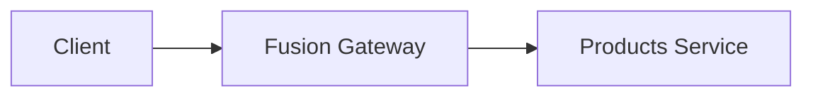

# website

The ChilliCream website and documentation, built on Next.js (MDX-based docs).

> [!NOTE]
> This is **not** the Next.js you may know from training data. APIs, conventions,
> and file structure may differ. Read the relevant guide in
> `node_modules/next/dist/docs/` before writing app/build code.

## Development

Use npm:

```bash
npm ci
npm run dev
```

## Visual tests

Install the website dependencies with `npm ci` and start Docker Desktop (or a
Linux Docker Engine). Visual tests require a running Linux-container daemon;
there is no host-browser fallback. Run these commands from `website`:

```bash
npm run test:visual
npm run test:visual -- --grep 'Button|Card' --workers=2
npm run test:visual:update -- --grep 'Button'
node --test scripts/visual-tests-docker.test.mjs
```

Both visual scripts build static Storybook on the host, then run the static
server, Chromium and screenshots in the same Docker renderer used by GitHub
Actions. Arguments after `--` are forwarded unchanged to Playwright. Direct
`npx playwright test` execution is rejected by the configuration guard.

The renderer is always `linux/amd64`, including on Apple Silicon. The official
Playwright 1.65.0 Noble image is pinned by digest in
`scripts/visual-tests.Dockerfile`; its only customization is npm 11.21.1 to
satisfy the repository's npm contract. A Playwright dependency upgrade must also
update and verify the image digest, runner version and configuration guard.
The runner logs the image, platform, Node, npm, Playwright and Chromium versions.

Each invocation stages a finite, read-only set of inputs into an owned Linux
worktree volume before installing dependencies. The host checkout, including its
`node_modules`, is never mounted during installation or capture. Staged inputs
are the website package/configuration, visual tests, built Storybook, and the
local Mocha visualizer package files needed by its `file:` dependency. The
worktree volume is removed on completion or interruption; the
workspace/runtime/lockfile-specific npm cache volume persists between invocations.

The test container has writable host mounts only for baselines in
`tests/visual/__screenshots__`, test artifacts in `test-results`, and CI HTML
reports in `playwright-report`. Those directories are created as the caller, so
written files retain the caller's UID/GID; Docker Desktop handles ownership on
Windows. Playwright `--output` paths must be relative paths within `test-results`
or `playwright-report`, which preserves artifacts without exposing another
checkout path for writes.

Ordinary comparisons do not update baselines, including missing images, unless
an explicit snapshot-update argument is supplied. Review screenshot diffs before
accepting updates: the shared renderer prevents OS, font and browser drift, but
does not add missing baselines or fix unintended UI changes.

Stories tagged `visual-reduced-motion` capture their authored static state with
`prefers-reduced-motion: reduce` applied before navigation; untagged stories keep
the default media preference. InsightsWindow and ProtectWindow opt in to capture
complete telemetry and static publish verdicts.

## Authoring Markdown Content

Docs live in `content/docs/<product>/...` as Markdown (`.md`) files and are
compiled with a custom MDX pipeline (`src/mdx-plugins.ts`). The rules below are
specific to this repo. Following them keeps the build green (several of these are
enforced at build time and will fail the build if violated).

### File layout

```
content/docs/<product>/<section>/<page>.md
content/docs/<product>/<section>/structure.yaml   # sidebar for that directory
content/docs/<product>/index.md                   # the product/section landing page
```

A directory's `index.md` is its landing page. Images do **not** live next to docs
(see [Images](#images)).

### Frontmatter

Every doc starts with YAML frontmatter:

```markdown
---
title: "Page Title"
description: "One-sentence summary used for SEO and Open Graph."
---
```

- `title` is rendered by the page layout as the page's single `<h1>`.
- **Do not repeat the title as the first heading in the body.** The layout already
  shows it, so a `# Page Title` at the top produces a duplicate heading.
- Headings are **automatically demoted one level** at build time
  (`src/remark/demoteHeadings.mjs`): write `#` in source and it renders as `<h2>`,
  `##` renders as `<h3>`, and so on. So author your top-level sections with `#`.

### Sidebar (`structure.yaml`)

The sidebar is built by walking the directory tree
(`src/helpers/buildContentTree.ts`). **Every directory that appears in the
navigation must contain a `structure.yaml`.**

```yaml
title: Section Title
items:
  - path: index # resolves to ./index.md, used as the section landing page
    title: Overview
  - path: getting-started # resolves to ./getting-started.md
    title: Getting Started
  - path: guides # a subdirectory -> must have its own structure.yaml
    title: Guides
```

- `items` is a **flat** list for the current directory only. Nesting is expressed
  through subdirectories, each with its own `structure.yaml`.
- A `path` resolves to `<path>.md` if that file exists, otherwise to the
  subdirectory `<path>/` (which must contain `index.md` to be linkable and a
  `structure.yaml`).
- A referenced item that doesn't exist on disk fails the build.

### Links

Link to other docs and blog pages directly by their target Markdown file using a
**relative filesystem path**. The `rewriteMdLinks` remark plugin rewrites these to
the correct route at build time, and **fails the build on broken links**.

```markdown
[Sibling page](./other-page.md)
[Sibling blog post](./2026-05-11-hot-chocolate-16.md)
[Page in another section](../guides/first-party-api.md)
[Cross-product page](../../hotchocolate/index.md)
[Deep link with anchor](./other-page.md#a-section)
[Same-page anchor](#a-section) <!-- just the hash, no file -->
```

- Always point at the `.md` file (e.g. `./cli.md`, not `/docs/.../cli`; and
  `./2026-05-11-hot-chocolate-16.md`, not `/blog/2026/05/11/hot-chocolate-16`).
- For a directory/section landing page, link to its `index.md`
  (e.g. `./guides/index.md`).
- Same-page anchors are just `#anchor` (no file path).
- Links to **product/marketing pages** (which have no Markdown source) use a
  **relative root-relative path**, e.g. `/products/nitro`, not an absolute
  `https://chillicream.com/products/nitro` URL.

### Images

Store images under a product namespace in `public/`, **not** next to the docs:

```
public/images/<product>-docs/<name>.webp
```

Reference them with a relative path that resolves **into `public/`**; the
`rewriteMdLinks` plugin rewrites it to a rooted URL (`/images/...`) at build time:

```markdown

```

(Use as many `../` as needed to reach the repo root from the doc's directory.) The
build fails if the referenced file does not exist.

### YouTube videos

Put a YouTube link **alone in its own paragraph**. The `youtubeEmbed` remark
plugin converts it into an embedded player; the link text becomes the play-button
label. A raw Markdown viewer (e.g. GitHub) still shows a clickable link.

```markdown
[Watch the video on YouTube](https://www.youtube.com/watch?v=VIDEO_ID)
```

A YouTube link inside surrounding prose is left as a normal inline link.

### Version badges

Put a `key: value` version line **alone in the paragraph directly below a
heading** to render version badges next to that heading. The `headingTags`
remark plugin picks it up; raw Markdown viewers still show a readable line.

```markdown
# `nitro fusion publish`

Since: 16.6.0, Nitro: 10.3.0
```

Supported keys (any subset, in any order, always rendered in the same order):

| Key     | Badge           | Meaning                                                                     |
| ------- | --------------- | --------------------------------------------------------------------------- |
| `Since` | `16.6.0+`       | Minimum package or tool version required for the documented feature.        |
| `Nitro` | `Nitro 10.3.0+` | Minimum self-hosted Nitro backend version (hovering the badge explains it). |

A paragraph is only converted when every pair uses a supported key, so ordinary
prose such as `Note: this is fine, really` is left alone.

The same line as the **first block of a document** (directly below the
frontmatter) puts the badges on the page title instead:

```markdown
---
title: "fusion Command"
---

Since: 16.6.0
```

### Admonitions

Use GitHub-style alert blockquotes. Supported kinds: `NOTE`, `TIP`, `WARNING`,
`CAUTION`, `EXPERIMENTAL`.

```markdown
> [!WARNING]
> This action cannot be undone.
```

### Code blocks

Use `shell` for command-line snippets. It is highlighted like Bash but renders
without a language label.

Use `sdl` for GraphQL type-system definitions and `graphql` for operations.

### Inline code highlighting

Inline code is not highlighted by default. Start it with a `#!lang` prefix
followed by a space to highlight it like a fenced block in the same language.
The prefix is removed from the rendered code.

```markdown
Declare it with `#!sdl directive @oneOf on INPUT_OBJECT`.
```

### Diagrams (Mermaid)

Prefer Mermaid over a static image for diagrams (flowcharts, sequence diagrams).
Use a fenced ```mermaid block. Styling (colors, rounded nodes, dimmed lines) is
applied automatically via the theme in `src/mdx-plugins.ts`, so don't hard-code
colors.

````markdown

````

> [!IMPORTANT]
> Keep node labels on a **single line**. Multi-line (`<br/>`) or auto-wrapped
> labels are mis-measured during headless rendering and get clipped at the box
> edge. If a label is long, keep it concise rather than wrapping it.

### MDX gotchas

- **Escape literal curly braces.** Raw `{...}` is parsed as a JavaScript
  expression and breaks the build (e.g. format specifiers, placeholders). Write
  `\{` and `\}`, or wrap the value in backticks.
- HTML comments (`<!-- ... -->`) are stripped before compilation; don't rely on
  them rendering.
- A range of MDX components is available (e.g. `Tabs`, `ExampleTabs`,
  `PackageInstallation`); see `mdx-components.tsx` for the full set.

### Generated Markdown copies

Every published documentation page has a generated `.md` alternate used by the
**Copy as Markdown** action. The export is derived from the rendered article, so
it preserves headings, prose, links, lists, admonitions, tables, and code while
excluding frontmatter, navigation, buttons, forms, SVG/canvas diagrams, and
elements marked with `data-llms-ignore`. Interactive MDX components contribute
their rendered textual content; purely visual components are omitted.

## Videos

The `/videos` section lists ChilliCream TV episodes. Each video is one Markdown
file in `content/videos/`, named `YYYY-MM-DD-slug.md`. The date prefix is the
publish date and the file name is the URL slug (`/videos/YYYY-MM-DD-slug`). The
slug is lowercase and hyphenated.

```markdown
---
title: "How to Use State in DataLoader for Context-Aware Fetching"
description: "One sentence shown on the video card and used for SEO."
youtubeId: "4Mw2A548OGM"
duration: "15:51"
uploadDate: "2025-05-01T02:55:26-07:00"
example: "https://github.com/<org>/<repo>/tree/main/<folder>"
author: "michael-staib"
tags:
  - dataloader
  - hotchocolate
---

In this episode, we explore how to make your DataLoaders stateful.

Hot Chocolate version used in this video: [15.1.4](https://www.nuget.org/packages/HotChocolate/15.1.4)
```

| Field         | Required | Meaning                                                                                                                  |
| ------------- | -------- | ------------------------------------------------------------------------------------------------------------------------ |
| `title`       | yes      | Page title and card heading.                                                                                             |
| `description` | yes      | One sentence for the card, meta description, and Open Graph.                                                             |
| `youtubeId`   | yes      | The 11-character YouTube video id. Quote it, so YAML always reads a string.                                              |
| `duration`    | yes      | Running time as YouTube shows it, e.g. `"12:18"` or `"1:02:03"`.                                                         |
| `uploadDate`  | yes      | The `uploadDate` from the YouTube watch page's HTML (`<meta itemprop="uploadDate">`). Its date must match the file name. |
| `example`     | no       | `https://` link to the example source code. Adds the **Example source** button.                                          |
| `author`      | no       | Slug of a presenter in `src/data/authors.ts`.                                                                            |
| `tags`        | no       | Lowercase, hyphenated topics. They become the filter chips on `/videos`.                                                 |

- The body is the video description, rendered below the player. It follows the
  same Markdown rules as docs and blog posts (links, images, admonitions, MDX
  gotchas).
- The poster image is the YouTube thumbnail. `npm run optimize-images`
  self-hosts it.
- An invalid file name or frontmatter fails the build with a message naming the
  file.

## Comparisons

The `/comparison` section compares ChilliCream products and approaches with the
alternatives. Each comparison is an article in `content/comparison/`, named
`slug.md` (or `slug/slug.md` with co-located files), and is served at
`/comparison/slug`. Name the file `<ours>-vs-<theirs>`, e.g.
`mocha-vs-mediatr.md`.

The frontmatter follows the blog: `title`, `description`, `date`, `tags`, and
the author fields are the same, and `metaTitle` overrides the `<title>` tag.
`date` is required because the file name carries no date. `featuredImage`
resolves against `public/images/comparison/<slug>/` and is required, because
the article's structured data needs an image. Three more fields close the
article and feed search engines:

| Field   | Meaning                                                                                                                                                                |
| ------- | ---------------------------------------------------------------------------------------------------------------------------------------------------------------------- |
| `about` | The things the article compares, each with a `name` and an optional `url` (a root-relative path or `https://` link). Emitted as the article's `about` structured data. |
| `faq`   | Questions with plain-text answers. Rendered after the article as "Frequently asked questions" and emitted as `FAQPage` structured data.                                |
| `cta`   | The closing call to action after the questions: a `title`, a `text`, `primary` and `secondary` buttons (each a `label` and `href`), and the `contact` link label.      |

````markdown
---
title: "Mocha vs. MediatR"
metaTitle: "Mocha vs MediatR: An MIT-Licensed MediatR Alternative"
description: "One or two sentences for the card and the meta description."
date: "2026-10-28"
tags: ["mocha", "comparison", "mediatr"]
featuredImage: "mocha-vs-mediatr.png"
author: Pascal Senn
authorUrl: https://github.com/pascalsenn
authorImageUrl: https://avatars.githubusercontent.com/u/14233220?v=4
about:
  - name: "Mocha"
    url: "/products/mocha"
  - name: "MediatR"
    url: "https://mediatr.io/"
faq:
  - question: "Is Mocha free for commercial use?"
    answer: "Plain text, no Markdown."
cta:
  title: "Try Mocha in your project."
  text: "One or two sentences, ending with a lead-in for the contact link."
  primary:
    label: "Get started with the mediator"
    href: "/docs/mocha/mediator"
  secondary:
    label: "Migrate from MediatR"
    href: "/docs/mocha/migration/coming-from-mediatr"
  contact: "Talk to us about your migration"
---

One paragraph that makes the case for our product.

# Commands and queries say what they do

One or two paragraphs on the difference, then the same code in both tools:

<CodeComparison>

```csharp filename="Mocha"
public record PlaceOrder(Guid ProductId) : ICommand<Guid>;
```

```csharp filename="MediatR"
public record PlaceOrder(Guid ProductId) : IRequest<Guid>;
```

</CodeComparison>
````

When comparing a product with another tool:

- Write the article to make the case for our product. Lead each section with
  what our product does better, then show the other tool.
- Show the difference in code. Give each section a `<CodeComparison>` with the
  same task in both tools, our product first, and label each block with
  `filename="<Tool>"`. The first block gets the accent, and so does any block
  whose label names the same tool before a colon, e.g.
  `filename="Mocha: billing service"`. Every code example shows our product;
  never show only the other tool. Keep lines under about 55 characters so the
  two columns do not scroll.
- Where a section explains a flow, add an animated diagram between the text
  and the code: `<MochaVisual name="retry" caption="One sentence on what it
shows." />`. The names are listed in `src/components/MochaVisual.tsx`.
- When a migration guide exists, end the section on moving from the other
  tool with a `<MigrationGuideCard>`: `from` is the other tool's name, and
  `href` is the guide, copied from `cta.secondary.href`. Keep `href`
  root-relative; JSX props are not checked at build time.
- After the sections, add a `# Feature comparison` section with the tables,
  each with `Feature`, our product, and the other tool as its header. The
  "Jump to" links at the top of the page point to this heading. List only what
  readers compare on; leave out features of the other tool we do not plan to
  build.
- Give a feature the other tool has and our product does not a status in its
  table cell: `<FeatureStatus status="planned" />`, `"in-progress"`, or
  `"in-review"`. Add `href` with the GitHub issue or pull request; the badge
  then links to it, and its hover tells readers to upvote or follow it.
- Put the questions in `faq`, not in the body, so they reach the structured
  data. Ask questions whose answers favor our product, never ones about what
  it lacks, and keep every answer supported by the article.
- Close with `cta`: the first button starts with our product, the second moves
  the reader on (a migration guide when one exists), and the contact link
  offers our team's help. `/docs/` links are checked at build time.
- Back every fact about the other tool with its official docs, license, or
  announcements, not third-party blogs. Link the source inline where the
  article states the fact, at least for licensing and prices.
- Link to docs pages relatively, e.g.
  `[quick start](../docs/mocha/quick-start.md)`.
